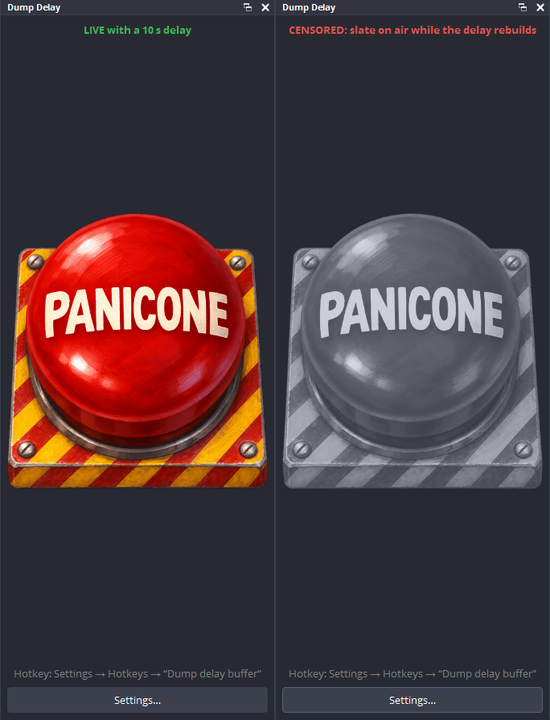
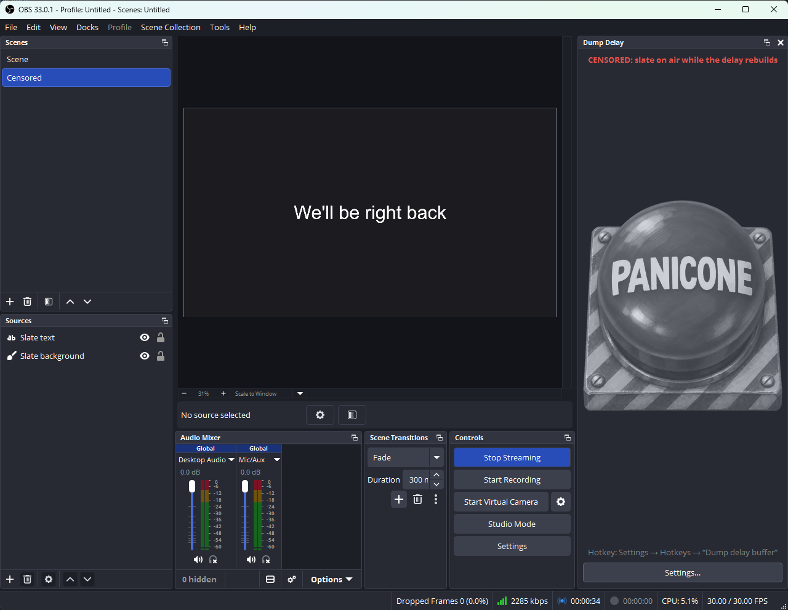
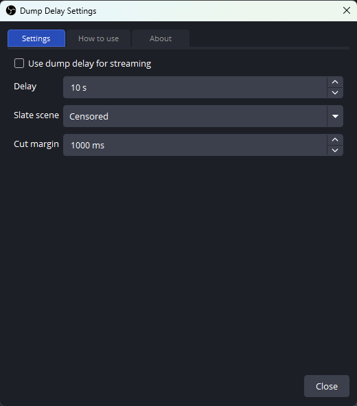

<div align="center">


# Dump Delay for OBS Studio

**A stream delay with a big red panic button.**
Something went wrong on stream? Press it: the seconds your viewers haven't seen yet are thrown away and never reach them.

 &nbsp;Plugin for <a href="https://obsproject.com">OBS Studio</a> 33 on Windows

[](https://github.com/ves-boop/obs-dump-delay/releases/latest)
[](LICENSE)


**English** · Italiano (the plugin follows OBS's language)

</div>

---

## Why

Twitch bans certain words and content, both on screen and in chat. Chat has
good tools (AutoMod, blocked terms, chat delay), but what you *say* or *show*
goes out live. A plain stream delay doesn't help: OBS's built-in delay can only
be cleared by ending the stream.

Dump Delay keeps the last few seconds in a buffer **before** they leave your
PC. Press the panic button and that buffer is thrown away, like the
["dump button"](https://en.wikipedia.org/wiki/Broadcast_delay) radio stations
use. The connection to Twitch never drops.

## What it looks like

<div align="center">

<br><sub>The Dump Delay panel: live (left), and right after a press, while the delay rebuilds (right).</sub>
<br><br>

<br><sub>After a press, OBS switches to the slate scene by itself, then back to your scene.</sub>
</div>

## What happens when you press the button

1. Your viewers are watching the stream **N seconds late** (10 by default).
2. Something goes wrong. You press **PANICONE** (or the hotkey) within those N seconds.
3. The buffered seconds are **thrown away**: they never reach Twitch.
4. Viewers see a short freeze, then your **slate scene** ("We'll be right back").
5. The delay rebuilds by itself while the slate is on, and OBS switches back to
   your scene. Audio is silenced during the slate.

Viewers see the slate for about twice the delay. You keep streaming the whole
time: no reconnect, no "stream ended".

## Install

Requirements: **Windows 10/11 64-bit** and **OBS Studio 33.x**. Close OBS before installing.

### Installer (recommended)

Download `obs-dump-delay-<version>-windows-x64-setup.exe` from the
[latest release](https://github.com/ves-boop/obs-dump-delay/releases/latest) and run it.
It checks your OBS version, asks you to close OBS if it's running, and comes
with an uninstaller (Settings → Apps). The installer speaks English and Italian.

> Windows SmartScreen may warn about an unknown publisher, because the
> installer isn't code-signed yet. Choose *More info → Run anyway*.

### Chocolatey

Download `obs-dump-delay.<version>.nupkg` from the
[latest release](https://github.com/ves-boop/obs-dump-delay/releases/latest), then in an
administrator terminal, in the download folder:

```powershell
choco install obs-dump-delay --source .
```

It depends on the `obs-studio` package (33.x).

### Manual (ZIP)

Extract `obs-dump-delay-<version>-windows-x64.zip` into
`C:\ProgramData\obs-studio\plugins\`, so that you get
`C:\ProgramData\obs-studio\plugins\obs-dump-delay\obs-dump-delay.dll`.

## Set up

1. Set up Twitch (server and stream key) as usual in OBS **Settings → Stream**.
2. Start OBS: the **Dump Delay** panel opens on the right (later: **Docks → Dump Delay**).
3. Click **Settings…** in the panel and tick **Use dump delay for streaming**.
4. Pick a **slate scene**, or press **Create** for a ready-made one. A still
   image or text works best: animations play in slow motion.
5. **Turn off OBS's own Stream Delay** (Settings → Advanced → Stream Delay).
   It is not compatible: it holds back the newest seconds *before* they reach
   this plugin, so the button couldn't remove them. The panel warns you if
   it's on.
6. Optional: assign a key in **Settings → Hotkeys → Dump delay buffer**.

<div align="center">

</div>

| Setting | Default | What it does |
|---|---|---|
| Delay | 10 s | How far behind live viewers are: your time to react. 3–60 s. |
| Slate scene | Censored | What viewers see after a press. |
| Cut margin | 1000 ms | Extra time cut after the press, covering the switch to the slate. Keep it above your transition duration. |

Settings are locked while you're live; they apply when a stream starts. The
settings window also has full instructions (**How to use**) in your language.

## Good to know

- **Chat isn't delayed** by this plugin. Use Twitch's AutoMod, blocked terms and chat delay for chat.
- Works with **Twitch and any RTMP server**. H.264 video and AAC audio (OBS's defaults).
- The keyframe interval is set to 2 seconds, as Twitch requires; it also keeps the freeze after a press short.
- OBS's **Settings → Stream** page can't show plugin services, so it keeps showing Twitch. Saving changes there turns dump delay off: tick it again in the panel.
- Not supported yet: RTMPS, Enhanced Broadcasting (multitrack), macOS and Linux.

## Build from source

See [docs/DEVELOPMENT.md](docs/DEVELOPMENT.md) for building, the release
script, the end-to-end test setup and how the delay rebuild works.

## Thanks

<a href="https://www.twitch.tv/la_locanda_dei_troll"></a>

Thanks to **[La Locanda dei Troll](https://www.twitch.tv/la_locanda_dei_troll)** on
Twitch for their support.

<br clear="left">

## Author and license

Created by **Valerio Enrico Salvo** (Ves).

Dump Delay is free software, licensed under the
[GNU General Public License, version 2 or (at your option) any later version](LICENSE),
the same license as OBS Studio.

<sub>Dump Delay is an independent project, not affiliated with or endorsed by the OBS Project.
OBS and OBS Studio are trademarks of the OBS Project, and the OBS logo is shown only to indicate
which software this plugin is for.</sub>
